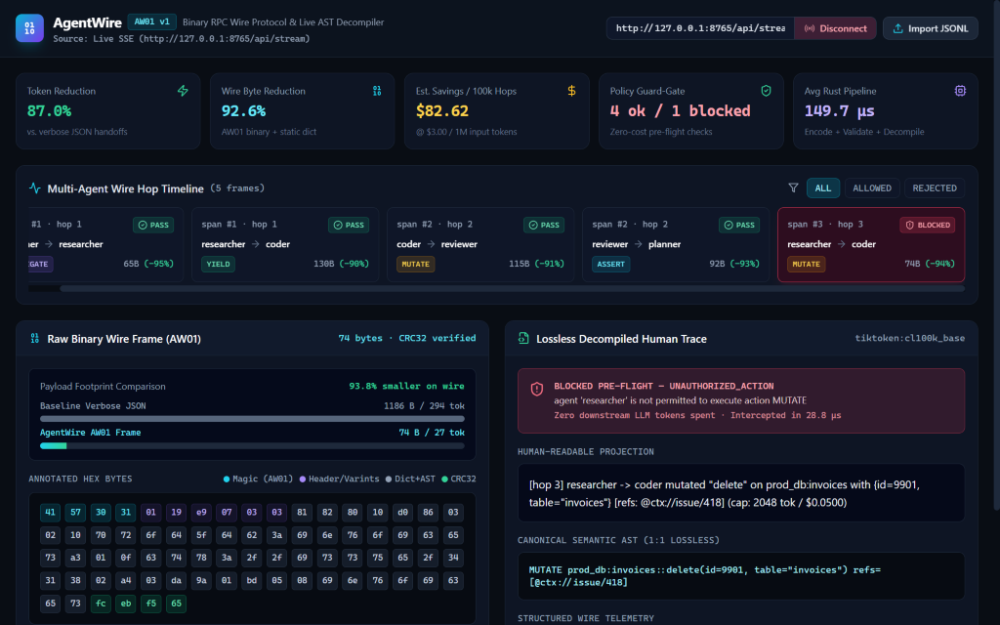

# AgentWire (`AW01` v0.2.1)

[](https://www.rust-lang.org/)
[](https://www.python.org/)
[](https://pypi.org/project/swarmwire/)
[](https://github.com/alok-108/agentwire/actions/workflows/ci.yml)
[](https://github.com/alok-108/agentwire/releases)
[](LICENSE)

> **A compact, cryptographically verifiable binary wire protocol and deterministic policy runtime for multi-agent AI systems.**
> Combines a typed Semantic AST (`AW01`), constant-time HMAC-SHA256 frame authentication with replay protection, two-phase Reserve/Settle budget accounting, a networked TCP RPC transport, and a 1:1 lossless live trace decompiler.



---

## Core Architecture

Rather than being another multi-agent orchestration framework, **AgentWire** is a verifiable communication and policy enforcement runtime designed to sit underneath multi-agent workflows (LangGraph, CrewAI, custom distributed services):

```text
[Agent A (Sender)]
        │ (Typed Intent / Action / Payload / Refs)
        ▼
┌─────────────────────────────────────────────────────────────┐
│  Layer 1: Semantic AST & AW01 Binary Codec (agentwire-core) │
│  • Actions: QUERY | MUTATE | DELEGATE | YIELD | ASSERT      │
│  • Static 1-byte dictionary, LEB128/ZigZag varints, BTreeMap│
│  • Constant-time HMAC-SHA256 + replay nonce/timestamp + CRC │
└─────────────────────────────────────────────────────────────┘
        │  === Length-Prefixed TCP RPC (~155 B signed) ===
        ▼
┌─────────────────────────────────────────────────────────────┐
│  Layer 2: Independent Receiver Guard-Gate (validator)       │
│  • Verifies HMAC-SHA256 (never trusts sender flags)         │
│  • Replay nonce cache & clock-skew freshness window         │
│  • RBAC, target namespace prefixes, hop/cycle & field rules │
│  • Two-phase Budget Ledger: Reserve → Settle / Release      │
└─────────────────────────────────────────────────────────────┘
        ▼
┌─────────────────────────────────────────────────────────────┐
│  Layer 3: Lossless Decompiler & Live Observability          │
│  ├─ Projects deterministic 1:1 Canonical AST to Agent B     │
│  └─ Streams Hex + Decompiled Human Trace via SSE / JSONL    │
└─────────────────────────────────────────────────────────────┘
        ▼
[Agent B (Receiver / Tool Executor)]
```

---

## Security & Trust Model

AgentWire explicitly separates **transport integrity**, **cryptographic authenticity**, and **authorization**:

1. **CRC32 vs. HMAC-SHA256:** CRC32 detects accidental transport corruption only. For untrusted or cross-process links, `sign_ast` / `verify_frame` authenticate the full canonical wire header, nonce, timestamp, and AST body using constant-time **HMAC-SHA256** (`32-byte` tag).
2. **Zero-Trust Receiver Validation:** The header `GUARD_VERIFIED` flag is advisory metadata only. `PolicyEngine` intentionally ignores it, and `AgentWireRpcServer` always independently verifies HMAC-SHA256 and re-evaluates policy on every inbound packet. `FrameHeader::mac_verified` is never serialized on the wire—it is only set to `true` by Rust `verify_and_decode_frame`.
3. **Replay & Freshness Protection:** Authenticated frames carry a `nonce` and `timestamp_ms`. `PolicyEngine` tracks seen `(source_agent, nonce)` pairs (`REPLAY_DETECTED`) and rejects frames outside `max_clock_skew_ms` (`EXPIRED_TIMESTAMP`).
4. **Two-Phase Budget Accounting (`Reserve → Settle / Release`):** Accepting a frame creates an active budget reservation (`reserved_tokens`, `reserved_micro_usd`). Once downstream execution completes, `settle_usage(trace_id, span_id, actual_tokens, actual_micro_usd)` records actual spend and releases unused budget back to the session pool. On error or timeout, `release_reservation` refunds 100%.

---

## Apples-to-Apples Benchmarks

Measured locally on Windows (`rustc 1.99.1`, `--release` PyO3 wheel, `Python 3.12`, `tiktoken:cl100k_base`) across **1,000 multi-agent hops** (`planner -> researcher -> coder -> reviewer`):

```bash
python benchmarks/token_latency_bench.py --iterations 250 --export-trace dashboard/public/sample-trace.jsonl
```

### A. Wire Serialization Size (Exact Same Semantic AST Struct)

| Wire Format (Identical Fields) | Avg Bytes / Hop | vs. Compact JSON | vs. RFC 8949 CBOR |
| --- | ---: | ---: | ---: |
| Indented JSON | 466.8 B | +28.2% | +59.3% |
| Compact Minified JSON | 364.0 B | baseline | +24.2% |
| RFC 8949 Canonical CBOR | 293.0 B | -19.5% | baseline |
| **AgentWire `AW01` (Unsigned + CRC32)** | **115.2 B** | **-68.3%** | **-60.7%** |
| **AgentWire `AW01` (HMAC-SHA256 + Nonce/TS + CRC32)** | **155.1 B** | **-57.4%** | **-47.1%** |

### B. LLM Input Context Tokens (`tiktoken:cl100k_base`)

> **Methodology note:** Binary wire compression alone does **not** reduce tokens billed by an LLM API. Token reductions apply only when the receiving application injects AgentWire's decompiled **Canonical AST** into model context instead of JSON/prompt boilerplate. Both baselines are reported separately below:

| Context Representation | Avg Tokens / Hop | Delta vs. Canonical AST |
| --- | ---: | ---: |
| **AgentWire Canonical AST** (`ACTION target::intent(...) refs=[...]`) | **52.8 tokens** | — |
| Minimal Compact JSON of exact same AST (structural baseline) | 62.2 tokens | **-15.3%** |
| Verbose multi-agent framework envelope (system/user + JSON tool call) | 312.2 tokens | **-83.1%** |

### C. Rust Core + HMAC-SHA256 + Two-Phase Guard-Gate Latency

| Operation (`perf_counter_ns`, 1,000 hops) | Mean | p99 |
| --- | ---: | ---: |
| Encode `AW01` (unsigned) | **3.70 µs** | — |
| Sign `AW01` (HMAC-SHA256 + nonce/ts) | **3.77 µs** | 16.20 µs |
| Constant-Time HMAC Verify + Decode + CRC32 | **5.00 µs** | 17.60 µs |
| Policy Guard-Gate Reserve + Settle | **4.38 µs** | — |
| Lossless 1:1 AST Decompilation | **11.41 µs** | — |
| **Full Authenticated Roundtrip Pipeline** | **24.55 µs** | **97.70 µs** |
| Forged Rogue `MUTATE` Blocked (`UNAUTHORIZED_ACTION`) | **4.00 µs** | Zero downstream API cost |
| Replay Attack Blocked (`REPLAY_DETECTED`) | **1.80 µs** | Zero downstream API cost |

---

## Quickstart

### Installation

```bash
pip install swarmwire
```

> The PyPI distribution is published as **`swarmwire`** and imports cleanly in Python as **`import agentwire`**.

### 1. Networked Authenticated TCP RPC Server & Client

```python
from agentwire import AgentWireRpcClient, AgentWireRpcServer

KEY = b"replace-with-32-byte-secret-key!"

def researcher_handler(decoded, summary):
    module = decoded["body"]["payload"]["module"]
    # Returns (result_payload, actual_tokens_used, actual_micro_usd_used)
    return ({"findings": f"verified schema for {module}"}, 220, 1_200)

with AgentWireRpcServer(signing_key=KEY) as server:
    server.register_handler("researcher", researcher_handler)
    host, port = server.address

    client = AgentWireRpcClient(host, port, signing_key=KEY, timeout_s=3.0, max_retries=2)
    resp = client.call(
        source_agent="planner",
        target_agent="researcher",
        action="DELEGATE",
        target="repo:billing",
        intent="analyze_schema",
        payload={"module": "invoices", "depth": 2},
        refs=["ctx://issue/418"],
        max_tokens=1500,
        max_micro_usd=25_000,
    )
    print(resp.ok, resp.payload)
    # Server automatically settled 220 actual tokens and returned 1,280 unused tokens to session pool!
```

### 2. Two-Phase Budget Reserve, Settle & Release

```python
from agentwire import WireClient

client = WireClient(signing_key=b"replace-with-32-byte-secret-key!")

sent = client.send(
    source_agent="planner",
    target_agent="researcher",
    action="DELEGATE",
    target="repo:billing",
    intent="analyze_schema",
    payload={"module": "invoices"},
    max_tokens=2000,
    max_micro_usd=40_000,
)

# After LLM/tool call finishes with 350 actual tokens ($0.005):
receipt = client.settle_usage(sent.event.trace_id, sent.event.span_id, 350, 5_000)
print(f"Released {receipt['released_tokens']} unused tokens back to session pool")
```

### 3. LangGraph & CrewAI Drop-In Adapters (Local or Remote TCP)

```python
from agentwire.adapters import CrewAIWire, LangGraphWire

# LangGraph state serializer middleware
lg = LangGraphWire(enable_safety_gate=True)

# CrewAI task bus dispatching to a remote AgentWireRpcServer over TCP
crew = CrewAIWire(signing_key=b"replace-with-32-byte-secret-key!")
crew.register_remote_role("researcher", "127.0.0.1", 9001)
```

---

## Repository Structure

```text
agentwire/
├── Cargo.toml
├── pyproject.toml
├── .github/workflows/ci.yml      # Cross-platform Linux + Windows CI (Rust, PyO3, pytest, Vite)
├── crates/
│   ├── agentwire-core/           # Typed AST, AW01 codec, HMAC-SHA256, proptest fuzzing, decompiler
│   ├── agentwire-validator/      # RBAC, replay/skew guards, two-phase Reserve/Settle budget ledger
│   └── agentwire-py/             # Thread-safe PyO3 + maturin native Python bindings
├── python/agentwire/
│   ├── client.py                 # WireClient, TokenEstimator, WireMetrics
│   ├── transport.py              # Length-prefixed TCP RPC server/client (timeouts, retries, HMAC)
│   ├── adapters/                 # LangGraphWire & CrewAIWire (local + remote TCP roles)
│   └── telemetry/                # TelemetryStream (JSONL sink + zero-dep HTTP/SSE server)
├── dashboard/                    # Dark-mode React + TypeScript + Tailwind TraceViewer UI
├── examples/
│   └── live_langgraph_crewai_demo.py
├── benchmarks/
│   └── token_latency_bench.py    # Apples-to-apples JSON/CBOR/AW01 + separated token benchmarks
└── tests/
    ├── test_codec_roundtrip.py
    ├── test_policy_guard.py
    ├── test_security_and_robustness.py  # Forged flags, HMAC, replay, 500-case FFI fuzz, 8-thread stress
    └── test_rpc_transport.py            # End-to-end TCP RPC, settlement, error refunds, retries
```

---

## Local Development, Testing & Dashboard

### 1. Run Rust Unit Tests & `proptest` Fuzz Suite
```bash
cargo test --workspace
```

### 2. Build Release PyO3 Extension & Run All 27 Python Tests
```bash
uv venv .venv
uv pip install --python .venv/Scripts/python.exe maturin pytest tiktoken
.venv/Scripts/maturin.exe develop --release
.venv/Scripts/pytest.exe
```

### 3. Run Benchmarks & Launch Live SSE Observability Dashboard
```bash
# Run apples-to-apples benchmark and export dashboard trace
.venv/Scripts/python.exe benchmarks/token_latency_bench.py \
  --iterations 250 \
  --export-trace dashboard/public/sample-trace.jsonl

# Terminal 1: Start React TraceViewer UI (http://localhost:5173)
cd dashboard && npm install && npm run dev

# Terminal 2: Stream live LangGraphWire + CrewAIWire traces over SSE (http://127.0.0.1:8765/api/stream)
.venv/Scripts/python.exe examples/live_langgraph_crewai_demo.py --keep-alive 0
```
